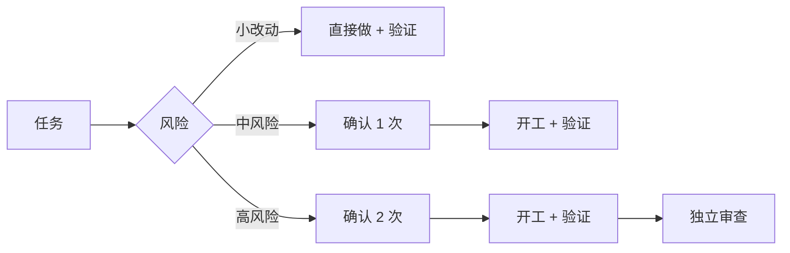

<div align="center">
  
  <h1>Spotter</h1>
  <p><b>先问清，再动手，改完有证据；图谱记得住，审计查得到，周报交得了差。</b></p>
  <p>风险分级工作流 · 知识图谱 · 独立审查 · audit 审计 · 周报沉淀 — 适用于 Codex / Claude Code / Antigravity</p>
  <p>中文 · <a href="README_EN.md">English</a></p>
  <p>
    
    
    
    
  </p>
</div>

<p align="center">
  
</p>

> 动画为输出示意，非真实会话录屏。

<p align="center">
  
</p>

一行安装（在项目根目录运行，Claude Code / Antigravity 把最后的 `codex` 换成 `claude-code` / `antigravity-cli`）：

```bash
npx --yes --allow-git=root github:hopkinson/spotter codex
```

**3 步开始：** 安装 → 重启助手 → 说一句 `/spot-plan 我想加……`

## 按风险分流

先弄清问题，再按风险选择流程：



| 没有 Spotter | 有 Spotter |
| --- | --- |
| 「已修复」，不知道验证过什么 | 复现 → 根因 → 修复 → 回归用例 → 验证结果 |

## 为什么用 Spotter

AI 能快速写出代码，但项目还需要明确的需求、可核实的根因和可靠的验证。Spotter 用规则和技能把这些步骤串起来：

| 场景 | 没有约定时可能发生 | Spotter 的做法 |
| --- | --- | --- |
| 修 Bug | 猜测原因后直接修改 | 先核实原因，无法复现时说明证据缺口，再按风险确定确认次数 |
| 做需求 | 自行补全需求，做完才发现理解有偏差 | 先问清会改变结果的取舍，再对齐行为、方案和验收场景。显式调用 `/spot-plan` 时走两次确认 |
| 交付改动 | 只说“完成了”，不知道验证过什么 | 确认方案后实施，报告运行过的验证和未覆盖的部分 |
| 审查代码 | 只看 diff，漏掉调用链和边界 | 用 `/spot-review` 结合需求、调用方和测试，报告具体问题和验证缺口 |
| 发布 | 把本地通过、推送成功和线上验证混为一谈 | 用 `/spot-release` 做预检；授权后跟踪部署，区分各阶段的证据 |
| 写周报 | 事后回忆工作，难以区分进展和结果 | 用 `/spot-log` 从本机记录生成草稿，区分本地通过与线上验证 |

这些是 Spotter 要求助手遵循的工作方式，实际效果仍取决于工具是否加载规则和技能，以及项目提供的验证条件。

维护者可以用 [工作流回放案例](tests/workflow-replay.md) 检查规则、技能或模型变更后的实际表现；仓库自动测试检查打包与脚本，不能代替助手行为回放。

业务项目中反复出现的问题，优先沉淀为项目内可运行的检查并接入现有测试或 CI，例如数据库时区回归；Spotter 记录实际执行结果和未覆盖的边界。

## 技能

Spotter 提供八个公开入口，内部辅助技能按需调用。

| 技能 | 什么时候用 | 做什么 |
| --- | --- | --- |
| [`spot-plan`](skills/spot-plan/SKILL.md) | 开始新需求或调整现有行为 | 澄清需求、边界和验收标准，用草图对齐后等你确认。 |
| [`spot-review`](skills/spot-review/SKILL.md) | 需要审查一组改动时 | 只读审查正确性、测试和冗余，报告具体问题与验证缺口。 |
| [`spot-audit`](skills/spot-audit/SKILL.md) | 写完一段功能，想检查累积风险时 | 只读排查漏洞、行为错误、数据丢失、并发问题和高风险测试缺口，也可扫全仓。 |
| [`spot-refactor`](skills/spot-refactor/SKILL.md) | 文件越写越大，想知道哪里值得重构时 | 只读检查职责混杂和重复实现，给出最小改法和回归验证建议。 |
| [`spot-release`](skills/spot-release/SKILL.md) | 准备发布或跟踪部署时 | 检查构建、回归和迁移；授权后推送、跟踪部署并核对线上结果。 |
| [`spot-log`](skills/spot-log/SKILL.md) | 记录任务结果或写周报时 | 把结果和验证证据保存在本机，按需生成周报草稿。 |
| [`spot-graph`](skills/spot-graph/SKILL.md) | 每次提交后更新代码图谱 | 初始化 CodeGraph，并在本地 Git 提交成功后增量刷新。 |
| [`spot-update`](skills/spot-update/SKILL.md) | 维护 Spotter 随包技能时 | 在 Spotter 仓库中检查上游版本和许可，报告候选更新；确认后再升级。 |

不同工具调用技能的方式可能不同；命令不可用时，可以直接说「用 spot-plan 帮我……」。Codex 中所有命令把 `/` 换成 `$`，例如 `$spot-plan`、`$spot-review`、`$spot-release`、`$spot-log`、`$spot-update`。

阶段审计用 `/spot-audit`，Codex 用 `$spot-audit`。默认检查相对项目默认分支的累积改动，包含未提交的修改。在默认分支上开发时，可用 `/spot-audit <起点提交或标签>` 指定从哪里开始。全仓排查用 `/spot-audit --full`。

用 `/spot-refactor [路径]` 查哪些代码值得重构，Codex 用 `$spot-refactor [路径]`。可以指定文件或目录，省略路径就从全仓筛查。编码收尾时，如果本轮改过的文件有具体的维护问题，也会附一句重构建议。

在目标仓库的主工作树运行 `/spot-graph`（Codex 用 `$spot-graph`）一次，之后主工作树中每次成功提交都会静默刷新图谱，失败时提示。用 `/spot-graph --off`（Codex 用 `$spot-graph --off`）关闭自动刷新。

在 Spotter 仓库中运行 `/spot-update`（Codex 用 `$spot-update`）检查随包技能的上游版本和许可；只报告候选更新，确认后再升级。

## 安装

需要 Node.js 22+ 和 Git。在目标项目根目录运行：

```bash
npx --yes --allow-git=root github:hopkinson/spotter codex
```

用 Claude Code 或 Antigravity CLI 时，把 `codex` 换成 `claude-code` 或 `antigravity-cli`。装好后重启助手。更新和移除命令见 [安装说明](INSTALL.md)。

## 移除

在目标项目根目录运行：

```bash
npx --yes --allow-git=root github:hopkinson/spotter --remove
```

只删除脚本安装的技能和规则标记段；项目自己的规则文件和私人日志保留。手动启用过的前端 hook 或快捷方式，先用对应命令关闭。移除中断时运行 `--recover`，详见 [安装说明](INSTALL.md)。

## 参与贡献

欢迎提 Issue 和 PR。运行 `npm test` 验证改动。

## 许可与第三方来源

本项目使用 [MIT 许可证](LICENSE)。`bundled-skills/` 中的第三方技能保留各自原许可，来源和版本见 [第三方技能来源](bundled-skills/SOURCES.md)。
