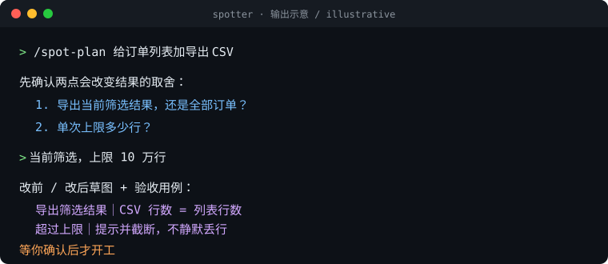
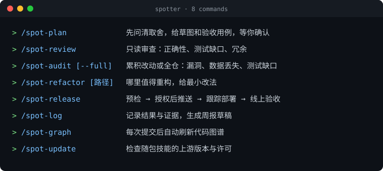
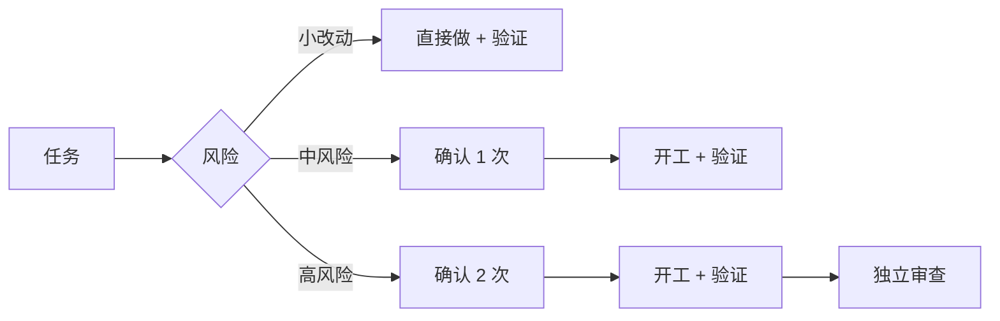

<div align="center">
  
  <h1>Spotter</h1>
  <p><b>先问清，再动手，改完有证据；图谱记得住，审计查得到，周报交得了差。</b></p>
  <p>风险分级工作流 · 知识图谱 · 独立审查 · audit 审计 · 周报沉淀 — 适用于 Codex / Claude Code / Antigravity</p>
  <p>中文 · <a href="README_EN.md">English</a></p>
  <p>
    
    
    
    
  </p>
</div>

<p align="center">
  
</p>

> 动画为输出示意，非真实会话录屏。

<p align="center">
  
</p>

一行安装（在项目根目录运行，Claude Code / Antigravity 把最后的 `codex` 换成 `claude-code` / `antigravity-cli`）：

```bash
npx --yes --allow-git=root github:hopkinson/spotter codex
```

**3 步开始：** 安装 → 重启助手 → 说一句 `/spot-plan 我想加……`

## 按风险分流

先弄清问题，再按风险选择流程：



| 没有 Spotter | 有 Spotter |
| --- | --- |
| 「已修复」，不知道验证过什么 | 复现 → 根因 → 修复 → 回归用例 → 验证结果 |

## 为什么用 Spotter

AI 写得快，但需求、根因和验证容易含糊。Spotter 用规则和技能把每一步钉住：

| 场景 | 常见问题 | Spotter 的做法 | 命令 |
| --- | --- | --- | --- |
| 做需求 | 自行补全，做完才发现理解偏差 | 先问清取舍，用草图和验收用例对齐 | `/spot-plan` |
| 修 Bug | 猜原因直接改 | 先复现、查根因，再按风险定确认次数 | 自动 |
| 交付 | 只说「完成了」 | 报告跑过的验证和未覆盖部分 | 自动 |
| 审查 | 只看 diff，漏调用链 | 结合需求、调用方和测试，只读报告 | `/spot-review` |
| 阶段审计 | 累积改动藏着漏洞和数据风险 | 只读排查安全、并发、数据丢失；`--full` 扫全仓 | `/spot-audit` |
| 重构 | 文件越写越大，无从下手 | 找职责混杂和重复实现，给最小改法 | `/spot-refactor` |
| 代码图谱 | 助手每次重新摸索代码结构 | 提交后自动增量刷新 CodeGraph | `/spot-graph` |
| 发布 | 本地通过、推送、线上验证混为一谈 | 预检；授权后跟踪部署，分阶段给证据 | `/spot-release` |
| 周报 | 事后回忆，分不清进展和结果 | 从本机记录生成草稿 | `/spot-log` |
| 维护技能 | 随包技能上游变了不知道 | 检查上游版本和许可，确认后升级 | `/spot-update` |

效果取决于工具是否加载规则和技能，以及项目的验证条件。维护者可用 [工作流回放案例](tests/workflow-replay.md) 检查改动后的实际表现；`npm test` 只检查打包与脚本。重复出现的问题，优先沉淀为项目内可运行的检查并接入测试或 CI。

## 命令

| 命令 | 用法 | 说明 |
| --- | --- | --- |
| [`/spot-plan`](skills/spot-plan/SKILL.md) | `/spot-plan 我想加……` | 澄清需求、边界和验收标准，草图对齐后等你确认 |
| [`/spot-review`](skills/spot-review/SKILL.md) | `/spot-review` | 只读审查一组改动的正确性、测试和冗余 |
| [`/spot-audit`](skills/spot-audit/SKILL.md) | `/spot-audit [起点提交或标签]`<br>`/spot-audit --full` | 默认查相对默认分支的累积改动（含未提交）；在默认分支上开发时指定起点；`--full` 扫全仓 |
| [`/spot-refactor`](skills/spot-refactor/SKILL.md) | `/spot-refactor [路径]` | 只读找值得重构的代码，路径可为文件或目录，省略则扫全仓。编码收尾时若本轮改动有具体维护问题，也会附一句建议 |
| [`/spot-release`](skills/spot-release/SKILL.md) | `/spot-release` | 预检构建、回归和迁移；授权后推送、跟踪部署、核对线上结果 |
| [`/spot-log`](skills/spot-log/SKILL.md) | `/spot-log` 或「写本周周报」 | 结果和验证证据存本机，按需生成周报草稿 |
| [`/spot-graph`](skills/spot-graph/SKILL.md) | `/spot-graph`<br>`/spot-graph --off` | 在目标仓库主工作树运行一次，之后每次成功提交静默刷新图谱，失败时提示；`--off` 关闭 |
| [`/spot-update`](skills/spot-update/SKILL.md) | `/spot-update` | 仅在 Spotter 仓库中使用：检查随包技能的上游版本和许可，只报告候选，确认后再升级 |

**Codex** 把 `/` 换成 `$`（如 `$spot-plan`）。命令不可用时，直接说「用 spot-plan 帮我……」。

## 安装

需要 Node.js 22+ 和 Git。在目标项目根目录运行：

```bash
npx --yes --allow-git=root github:hopkinson/spotter codex
```

用 Claude Code 或 Antigravity CLI 时，把 `codex` 换成 `claude-code` 或 `antigravity-cli`。装好后重启助手。更新和移除命令见 [安装说明](INSTALL.md)。

## 移除

在目标项目根目录运行：

```bash
npx --yes --allow-git=root github:hopkinson/spotter --remove
```

只删除脚本安装的技能和规则标记段；项目自己的规则文件和私人日志保留。手动启用过的前端 hook 或快捷方式，先用对应命令关闭。移除中断时运行 `--recover`，详见 [安装说明](INSTALL.md)。

## 参与贡献

欢迎提 Issue 和 PR。运行 `npm test` 验证改动。

## 许可与第三方来源

本项目使用 [MIT 许可证](LICENSE)。`bundled-skills/` 中的第三方技能保留各自原许可，来源和版本见 [第三方技能来源](bundled-skills/SOURCES.md)。