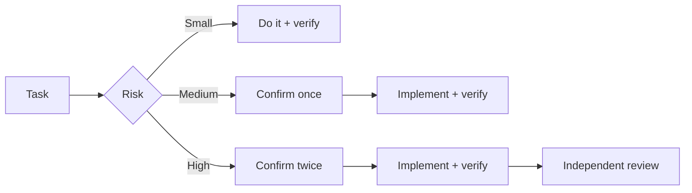

<div align="center">
  
  <h1>Spotter</h1>
  <p><b>Clarify first. Prove after. Remember everything.</b></p>
  <p>Risk-aware workflows with knowledge graph, audits &amp; weekly reports — for Codex / Claude Code / Antigravity</p>
  <p><a href="README.md">中文</a> · English</p>
  <p>
    
    
    
    
  </p>
</div>

<p align="center">
  
</p>

> Illustrative animation, not a recording of a real session.

<p align="center">
  
</p>

One-line install (run in your project root; for Claude Code / Antigravity CLI replace `codex` with `claude-code` / `antigravity-cli`):

```bash
npx --yes --allow-git=root github:hopkinson/spotter codex
```

**Get started in 3 steps:** install → restart your assistant → say `/spot-plan I want to add ...`

## Routed by risk



| Without Spotter | With Spotter |
| --- | --- |
| "Fixed", with no idea what was checked | Reproduce → root cause → fix → regression test → verification result |

## Why Spotter

AI writes fast, but requirements, root causes, and verification get fuzzy. Spotter pins down each step with rules and skills:

| Situation | Common problem | What Spotter does | Command |
| --- | --- | --- | --- |
| Building a feature | Fills in gaps itself; mismatch found after the fact | Asks about trade-offs first, aligns on a sketch and acceptance cases | `/spot-plan` |
| Fixing a bug | Guesses the cause and edits | Reproduces and finds the root cause first; confirmations scale with risk | automatic |
| Delivering | Just says "done" | Reports checks run and what remains uncovered | automatic |
| Reviewing | Reads only the diff, misses callers | Checks requirements, callers, and tests; read-only report | `/spot-review` |
| Stage audit | Accumulated changes hide vulnerabilities and data risks | Read-only check for security, concurrency, data loss; `--full` scans the repo | `/spot-audit` |
| Refactoring | File keeps growing, unclear where to start | Finds mixed responsibilities and duplication, suggests a minimal change | `/spot-refactor` |
| Code graph | Assistant re-learns the code structure every time | Refreshes CodeGraph incrementally after commits | `/spot-graph` |
| Releasing | Local pass, push, and production check blur together | Preflight; after authorization, tracks deployment with evidence per stage | `/spot-release` |
| Weekly report | Written from memory; progress vs. results unclear | Drafts from local records | `/spot-log` |
| Maintaining skills | Upstream changes go unnoticed | Checks upstream versions and licenses; upgrades after confirmation | `/spot-update` |

Results depend on whether the tool loads the rules and skills, and on the project's verification setup. Maintainers can use the [workflow replay cases](tests/workflow-replay.md) to check behavior after changes; `npm test` only checks packaging and scripts. For recurring problems, prefer runnable checks inside the project, wired into tests or CI.

## Commands

| Command | Usage | Description |
| --- | --- | --- |
| [`/spot-plan`](skills/spot-plan/SKILL.md) | `/spot-plan I want to add ...` | Clarifies requirements, boundaries, and acceptance criteria; aligns on a sketch and waits for confirmation |
| [`/spot-review`](skills/spot-review/SKILL.md) | `/spot-review` | Read-only review of correctness, tests, and redundancy |
| [`/spot-audit`](skills/spot-audit/SKILL.md) | `/spot-audit [base commit or tag]`<br>`/spot-audit --full` | Defaults to changes since the default branch (including uncommitted); pass a base when on the default branch; `--full` scans the whole repo |
| [`/spot-refactor`](skills/spot-refactor/SKILL.md) | `/spot-refactor [path]` | Read-only search for refactoring worth doing; path can be a file or directory, omit to scan the repo. After coding, adds a brief suggestion if changed files have a concrete maintenance problem |
| [`/spot-release`](skills/spot-release/SKILL.md) | `/spot-release` | Preflights builds, regressions, and migrations; after authorization, pushes, tracks deployment, and checks production |
| [`/spot-log`](skills/spot-log/SKILL.md) | `/spot-log` or "write this week's report" | Saves results and verification evidence locally; drafts reports on request |
| [`/spot-graph`](skills/spot-graph/SKILL.md) | `/spot-graph`<br>`/spot-graph --off` | Run once in the target repo's main worktree; later successful commits refresh the graph silently and report failures; `--off` disables |
| [`/spot-update`](skills/spot-update/SKILL.md) | `/spot-update` | Spotter repo only: checks upstream versions and licenses of bundled skills, reports candidates, upgrades after confirmation |

**Codex:** replace `/` with `$` (e.g. `$spot-plan`). If a command is unavailable, ask your assistant to "use spot-plan to ...".

## Install

Requires Node.js 22+ and Git. Run this command from your project root.

```bash
npx --yes --allow-git=root github:hopkinson/spotter codex
```

For Claude Code or Antigravity CLI, replace `codex` with `claude-code` or `antigravity-cli`. Restart your assistant after installation. See the [installation guide](INSTALL.md) for update and removal commands.

## Remove

Run this command from your project root:

```bash
npx --yes --allow-git=root github:hopkinson/spotter --remove
```

It only removes the skills and rule block the installer added. Your own rule files and private logs are kept. Turn off any manually enabled frontend hooks or shortcuts first. If removal is interrupted, run `--recover`; see the [installation guide](INSTALL.md).

## Contributing

Issues and pull requests are welcome. Run `npm test` to verify changes.

## License and third-party sources

This project is licensed under the [MIT License](LICENSE). Third-party skills in `bundled-skills/` retain their own licenses; see [third-party skill sources](bundled-skills/SOURCES.md) for origins and versions.
