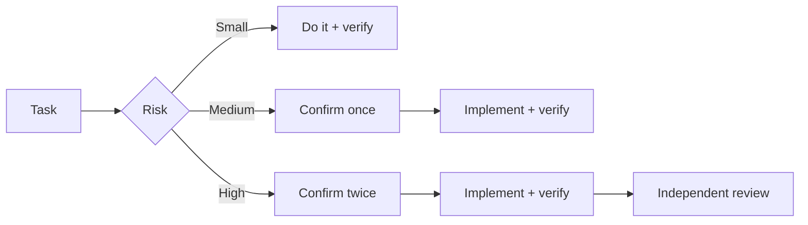

<div align="center">
  
  <h1>Spotter</h1>
  <p><b>Clarify first. Prove after. Remember everything.</b></p>
  <p>Risk-aware workflows with knowledge graph, audits &amp; weekly reports — for Codex / Claude Code / Antigravity</p>
  <p><a href="README.md">中文</a> · English</p>
  <p>
    
    
    
    
  </p>
</div>

<p align="center">
  
</p>

> Illustrative animation, not a recording of a real session.

<p align="center">
  
</p>

One-line install (run in your project root; for Claude Code / Antigravity CLI replace `codex` with `claude-code` / `antigravity-cli`):

```bash
npx --yes --allow-git=root github:hopkinson/spotter codex
```

**Get started in 3 steps:** install → restart your assistant → say `/spot-plan I want to add ...`

## Routed by risk



| Without Spotter | With Spotter |
| --- | --- |
| "Fixed", with no idea what was checked | Reproduce → root cause → fix → regression test → verification result |

## Why Spotter

AI can write code quickly, but projects still need clear requirements, verifiable root causes, and reliable validation. Spotter connects these steps through rules and skills:

Make and verify small, low-risk changes directly. Confirm the plan once for medium-risk work. Use two confirmations for high-risk work or when the user explicitly requests the full workflow.

| Situation | Without a shared approach | With Spotter |
| --- | --- | --- |
| Fixing a bug | Guess the cause and start editing | Check the cause first, report any gaps in reproduction, and match the confirmation process to the risk. |
| Building a feature | Fill in missing requirements and discover a mismatch later | Resolve decisions that affect the outcome, then agree on behavior, approach, and acceptance cases. An explicit `/spot-plan` request uses two confirmations. |
| Delivering changes | Say “done” without explaining what was checked | Implement the confirmed plan and report the checks run and what remains uncovered. |
| Reviewing code | Look only at the diff and miss callers or edge cases | Use `/spot-review` to examine requirements, callers, and tests, and report concrete findings and verification gaps. |
| Releasing | Mix up local success, a successful push, and production verification | Use `/spot-release` for preflight checks; after authorization, follow deployment and distinguish evidence at each stage. |
| Writing a weekly report | Rely on memory and blur progress with results | Use `/spot-log` to draft a report from local records, distinguishing local checks from production verification. |

These are the working practices Spotter asks assistants to follow. Results depend on whether the tool loads the rules and skills and on the verification available in the project.

Maintainers can use the [workflow replay cases](tests/workflow-replay.md) to check assistant behavior after changes to rules, skills, or models. Repository tests do not replace those replays.

## Skills

Spotter provides eight public entry points. Rules and entry points call internal helper skills as needed.

| Skill | When to use it | What it does |
| --- | --- | --- |
| [`spot-plan`](skills/spot-plan/SKILL.md) | Starting a feature or changing behavior | Clarifies requirements, boundaries, and acceptance criteria; aligns on a sketch and waits for confirmation. |
| [`spot-review`](skills/spot-review/SKILL.md) | Reviewing a set of changes | Performs a read-only review of correctness, tests, and redundancy; reports findings and verification gaps. |
| [`spot-audit`](skills/spot-audit/SKILL.md) | Checking for risks after a stretch of development | Performs a read-only check for vulnerabilities, bugs, data loss, concurrency issues, and high-risk test gaps. Can also audit the whole repository. |
| [`spot-refactor`](skills/spot-refactor/SKILL.md) | Deciding whether a growing file is worth refactoring | Performs a read-only check for mixed responsibilities and duplicated logic, then suggests a minimal change and how to verify behavior. |
| [`spot-release`](skills/spot-release/SKILL.md) | Preparing or tracking a release | Checks builds, regressions, and migrations; after authorization, pushes, follows deployment, and checks production results. |
| [`spot-log`](skills/spot-log/SKILL.md) | Recording task results or writing a weekly report | Saves results and verification evidence locally and drafts reports on request. |
| [`spot-graph`](skills/spot-graph/SKILL.md) | Keeping the code graph current after commits | Initializes CodeGraph and refreshes it incrementally after successful local commits. |
| [`spot-update`](skills/spot-update/SKILL.md) | Maintaining bundled skills | Checks upstream versions and licenses in the Spotter repository, reports update candidates, and waits for confirmation before upgrading. |

Invocation varies by tool. If a command is unavailable, ask your assistant to use the skill by name. In Codex, replace `/` with `$` for every command, e.g. `$spot-plan`, `$spot-review`, `$spot-release`, `$spot-log`, `$spot-update`.

Run `/spot-audit` (`$spot-audit` in Codex) to check changes relative to the project's default branch, including uncommitted work. When working on the default branch, pass a starting commit or tag with `/spot-audit <base>`. Run `/spot-audit --full` to audit the whole repository.

Use `/spot-refactor [path]` (`$spot-refactor [path]` in Codex) to find worthwhile refactoring opportunities in a file, a directory, or the whole repository. After a coding task, Spotter also adds a brief refactoring suggestion when a file changed in that task has a concrete maintenance problem.

Run `/spot-graph` (`$spot-graph` in Codex) once in the target repository's main worktree. Successful commits in that worktree refresh the graph silently. Use `/spot-graph --off` (`$spot-graph --off` in Codex) to disable the hook.

Run `/spot-update` (`$spot-update` in Codex) in the Spotter repository to check upstream versions and licenses of bundled skills. It only reports candidates and waits for confirmation before upgrading.

## Install

Requires Node.js 22+ and Git. Run this command from your project root.

```bash
npx --yes --allow-git=root github:hopkinson/spotter codex
```

For Claude Code or Antigravity CLI, replace `codex` with `claude-code` or `antigravity-cli`. Restart your assistant after installation. See the [installation guide](INSTALL.md) for update and removal commands.

## Remove

Run this command from your project root:

```bash
npx --yes --allow-git=root github:hopkinson/spotter --remove
```

It only removes the skills and rule block the installer added. Your own rule files and private logs are kept. Turn off any manually enabled frontend hooks or shortcuts first. If removal is interrupted, run `--recover`; see the [installation guide](INSTALL.md).

## Contributing

Issues and pull requests are welcome. Run `npm test` to verify changes.

## License and third-party sources

This project is licensed under the [MIT License](LICENSE). Third-party skills in `bundled-skills/` retain their own licenses; see [third-party skill sources](bundled-skills/SOURCES.md) for origins and versions.
