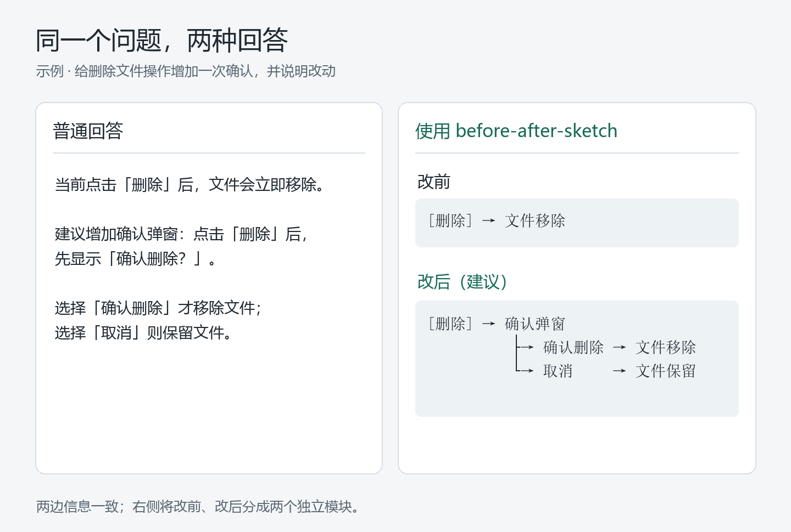
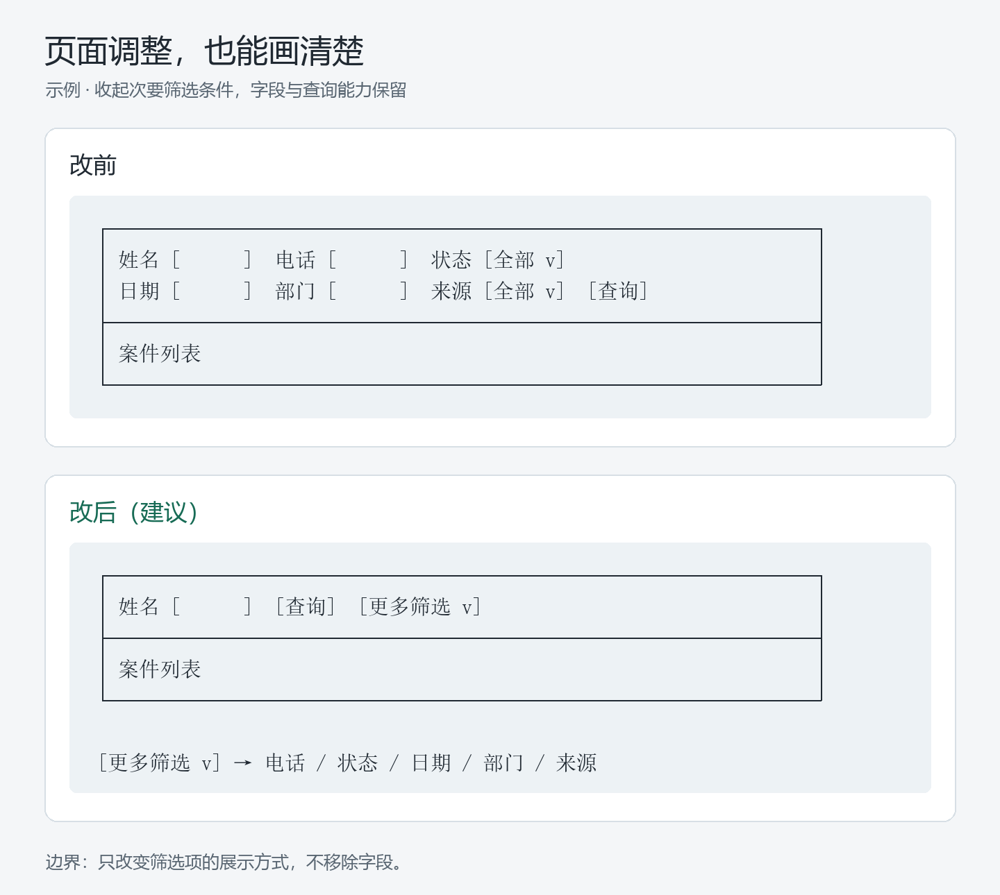

# before-after-sketch

**少读长文，用文本草图看懂改前与改后。**

Less reading. Clear before-and-after text sketches for AI answers.



*示例排版，并非真实产品截图。图片文字版见[对照示例](assets/examples.md)。*

## 安装与使用

技能是纯 Markdown，使用时无依赖、无需运行脚本。核心文件是 [SKILL.md](SKILL.md)。

### Codex

将仓库克隆到个人技能目录（如果配置了 `CODEX_HOME`，使用其下的 `skills/`）：

```sh
git clone https://github.com/hopkinson/before-after-sketch.git ~/.codex/skills/before-after-sketch
```

在支持技能调用的会话中使用：

```text
$before-after-sketch 这个页面调整方案，给我前后对比。
```

### 其他 AI 工具

将 `SKILL.md` 的正文作为自定义指令，或放入工具支持的技能目录；具体安装方式以对应工具为准。

## 页面案例

输入：`$before-after-sketch 收起次要筛选条件，给我改前改后对比。`



## 输出规则

- 页面画线框，流程画箭头，代码结构画树。
- 改前、改后各一个独立模块，标题放框外。
- 图外默认不解释，必要时最多补 3 条短句；说“展开”再详细说明。
- 未知现状标注“待确认”，未实施方案标注“建议”，不把建议当成完成。

## 边界

技能改变回答的表达方式，不会把“建议”当成“已经修改”，也不会把“画个草图”当成修改代码的授权。用户要求实现时，仍需完成实现和必要验证。

配图均为示例，可用 [tools/render_readme.py](tools/render_readme.py) 重新生成（仅制作图片需要 Python、Pillow 与中文字体，详见脚本开头）。

## License

[MIT](LICENSE)
