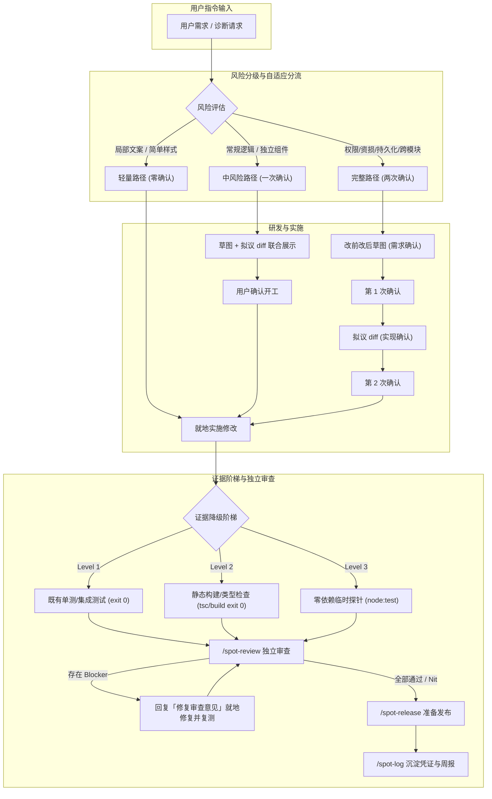

# Spotter 命令工作流全景规范 (Spotter Workflow Specification)

> **版本**：0.1.2（最新优化版）  
> **核心原则**：查得清全景，控得住风险，交得出证据。

---

## 一、核心设计哲学与防护体系

Spotter 面向真实工程协作设计，通过**分级确认机制**防止无脑修改业务代码，通过**证据降级阶梯**确保交付质量闭环。

### 1. 三级证据降级阶梯 (Evidence Ladder)
为了解决在纯前端、轻量脚本或无单测项目中因“强行要求单测退出码 0”导致的流程卡死，建立统一降级标准：
- **Level 1（首选）**：项目既有单测/集成测试（如 `npm test`、`pytest`、`go test` 等），附带真实终端输出与退出码 0。
- **Level 2（次选）**：静态类型检查与生产构建（如 `tsc --noEmit`、`npm run build`、语法解析检查），证明改动零破坏。
- **Level 3（三选）**：零依赖临时探针（使用 Node 内置 `node --test` 或 Python `unittest` 单文件针对病灶做断言）。
- **纯 UI 渲染/样式缺口**：如实记录浏览器走查结果，并显式标注自动化缺口，不阻断流程流转。

---

## 二、命令全景矩阵 (Master Command Matrix)

| 命令 | 典型指令 | 核心防护与价值 | 确认级别 | 产出物 | 后续衔接 |
| :--- | :--- | :--- | :---: | :--- | :--- |
| **`/spot-plan`** | 「加个导出功能」 | 风险自适应分流，草图定需求，拟议 diff 锁方案 | 一次/两次确认 | 交互草图、验收用例、拟议 diff | 实施 ➔ 测试 ➔ `spot-review` |
| **`/spot-bug`** | 「排查登录超时」 | 只读复现，排查熔断，追查真因并举一反三 | 确认后开工 | 根因报告、回归用例、修复 diff | 确认开工 ➔ 回归测试 ➔ `spot-review` |
| **`/spot-trace`**| 「理一下这个模块」 | 全景走查界面、交互、端到端链路与带风险标注路线 | 只读走查 | ASCII 草图、调用拓扑、代码清单、分级路线 | 选步自适应接力实施 / `spot-plan` |
| **`/spot-review`**| 「帮我看看改动」 | 独立只读审查正确性、安全、负载、测试与精简度 | 只读审查 | `[Blocker]` / `[Nit]` 清单 | Blocker 自愈修复 / `spot-release` |
| **`/spot-audit`** | 「阶段风险审计」 | 排查越权、注入、并发隐患与测试缺口，分级接力 | 只读审计 | 漏洞清单、验证证据 | 阻断调 `spot-bug` / 批量出 diff 修复 |
| **`/spot-refactor`**| 「代码体检重构」 | 体检大文件与重复逻辑，立守护测试原地接力实施 | 确认后开工 | 重构候选清单、守护测试、重构 diff | 一次确认开工 ➔ 直通 `spot-review` |
| **`/spot-release`** | 「准备发布 / 部署」 | 多适配器（GitHub/Git/npm）预检，授权推送，盯部署 | 关键步骤确认 | 预检报告、CI 跟踪日志、线上验收凭证 | 交付 `spot-log` 记日志 |
| **`/spot-graph`** | 「建个代码图谱」 | 初始化本地 CodeGraph，提交后自动增量刷新图谱 | 零确认 | 受管 Git hook、知识图谱索引库 | 本地后台静默运行 |
| **`/spot-log`** | 「写本周周报」 | 优先沉淀至当前项目 `.agents/`，自动起草结构化周报 | 零确认 | `worklog.jsonl`、自然周周报 Markdown | 复制/归档周报 |
| **`/spot-update`** | 「升级随包技能」 | 检查第三方随包技能上游版本与开源许可漂移 | 确认后升级 | 升级候选报告、许可对比 | 授权更新并回放场景 |

---

## 三、每个命令的详细流程规范

### 1. `/spot-plan`（需求澄清与方案确认）
- **触发**：显式调用 `/spot-plan` 或提出新功能需求。
- **流程步骤**：
  1. **事实核查**：读取现有代码、路由、组件与约束，不向用户询问能查到的事实。
  2. **关键取舍问询**：基于 `spot-grilling`，逐题询问会改变方案的关键取舍，每题附带推荐选项。
  3. **改前/改后草图与自适应分流**：
     - *常规中风险*（无高危因素）：合并输出 ASCII 改前改后草图与基于现有代码的最小拟议 diff，等待**一次确认**开工。
     - *高危完整路径*（涉及权限、金额、持久化、跨模块等）：先输出草图与验收标准，等待**第 1 次确认**；再输出核心拟议 diff 与边界用例，等待**第 2 次确认**。
  4. **前端专属防漏**：若涉及界面/交互，自动加载 `spot-impeccable` 与 `spot-design-taste-frontend` 规范。
  5. **收尾流转闭环**：代码实施并取得测试证据后，在【下一步操作】中**默认推荐调用 `spot-review`**；若审查出 Blocker，用户回复「修复审查意见」时主会话直接修复并复测，无需重复审批方案。

---

### 2. `/spot-bug`（只读排查与诊断）
- **触发**：显式调用 `/spot-bug <错误描述>` 或报故障。
- **流程步骤**：
  1. **复现回路与排查熔断**：
     - 建立最小复现路径（测试用例、单步脚本、curl）。
     - *熔断机制*：连续 2 次复现失败禁止盲猜，必须加临时日志打印入参；连续 3 次未果主动提示清除上下文重新输入，防止幻觉污染。
  2. **端到端链路追溯**：`触发入口 → 传参校验 → 业务逻辑 → 故障点`，输出明确因果（`原因 X → 导致现象 Y`）。
  3. **最小修复拟议 diff**：只触达病灶，不引入无关重构。
  4. **举一反三与确认**：列出回归用例（`测什么情况 ｜ 应该看到什么结果`），并扫描全仓同类隐患。
  5. **实施与流转**：等待用户确认后开工落测试与修复，验证通过后直通 `spot-review`。

---

### 3. `/spot-trace`（功能全景走查）
- **触发**：显式调用 `/spot-trace <功能名或模块>`。
- **流程步骤**：
  保持只读，按序输出 5 大核心模块：
  1. **界面/场景草图**：纯文本 ASCII 线框或数据卡片。
  2. **交互状态流转**：提炼主干与异常分支（Loading、空状态、校验失败、网络异常）。
  3. **调用与数据链路**：拓扑式端到端数据流。
  4. **真实代码清单**：精确到真实存在的文件路径与函数符号（`path/to/file.ts:line`）。
  5. **实施/排查路线（带风险标注）**：在每一步前置标注 `[轻量/直改]`、`[中风险/一次确认]` 或 `[完整路径/两次确认]`。
- **收尾流转**：用户回复「开始实施第 X 步」时，自适应匹配该步的风险级别就地接力实施，无需重新开题。

---

### 4. `/spot-review`（独立代码审查）
- **触发**：任务实施完成后调用 `/spot-review` 做质量把关。
- **流程步骤**：
  1. **锁定范围与基线**：读取已确认需求、当前任务 diff 与真实调用方。
  2. **六维审查**：按正确性、安全、负载、测试、性能、精简度按序严格核对。
  3. **双级意见分类**：
     - `[Blocker]`：阻断合并（逻辑缺陷、越权、资损、崩溃风险等）。
     - `[Nit]`：非阻断建议（局部可读性、命名优化、轻微冗余）。
- **审查修复闭环**：
  - 存在 Blocker 时，在【下一步操作】提示 `回复「修复审查意见」直接修复并复测`；用户确认后主会话就地修复并复测。
  - 通过时直接提供选项：`调用 spot-release 准备发布` 或 `回复「直接提交」结束任务`。

---

### 5. `/spot-audit`（阶段风险审计）
- **触发**：阶段性开发后或发版前调用 `/spot-audit [起点]` 或 `spot-audit --full`。
- **流程步骤**：
  1. **确定审计范围**：以指定 commit/tag 为起点或扫描全仓。
  2. **只读深入扫描**：优先查鉴权、输入校验、密钥暴露、并发竞态、数据丢失与测试盲区。
  3. **分级接力收尾**：
     - 单项高危阻断：提示 `调用 spot-bug 针对第 X 项高危问题制定修复`。
     - 多项同类轻中度隐患：提示 `回复「批量修复第 X、Y 项轻中度问题」原地出 diff 实施`，一次确认后批量开工。
     - 无严重漏洞：推进 `spot-release` 发布。

---

### 6. `/spot-refactor`（代码体检与重构接力）
- **触发**：调用 `/spot-refactor [路径]`。
- **流程步骤**：
  1. **体检分析**：扫描大文件、高频变动模块与重复规则，评估具体维护代价。
  2. **原地接力机制**：
     - 用户回复「重构第 X 项」时，跳过需求草图与问询，直接进入重构方案拟定。
     - **守护防线**：若目标代码缺乏测试，**强制先新增轻量守护测试**锁定既有行为，再给重构 diff。
  3. **开工与流转**：给出拟议 diff 与等价断言，一次确认开工，完成后直通 `spot-review`。

---

### 7. `/spot-release`（发布与部署跟踪）
- **触发**：发版前调用 `/spot-release`。
- **流程步骤**：
  1. **只读预检**：运行生产构建与回归测试，检查数据迁移文件与回滚限制。
  2. **多适配器支持**：
     - **GitHub Actions 模式**：匹配 workflow 并通过 `gh run watch` 实时跟踪到终态。
     - **原生 Git 模式**：授权后执行 `git push` 并核对远端 SHA 一致性。
     - **npm / 库发布模式**：预检版本号与打包清单，授权后执行 `npm publish` 并验证 registry。
  3. **线上验证与异常恢复**：核对实际版本与健康检查；失败时定位步骤并给出回滚方案。
  4. **沉淀闭环**：收尾交接给 `spot-log` 留存发布记录。

---

### 8. `/spot-graph`（代码图谱 CodeGraph）
- **触发**：调用 `/spot-graph`（关闭为 `spot-graph --off`）。
- **流程步骤**：
  1. 隔离安装特定版本的 CodeGraph 运行时。
  2. 初始化项目代码图谱并安装本地 Git `post-commit` hook。
  3. 每次 `git commit` 成功后静默在后台增量刷新图谱，辅助大型项目调用拓扑分析。

---

### 9. `/spot-log`（任务凭证与周报沉淀）
- **触发**：收尾记录或调用 `/spot-log weekly`（或指令「写本周周报」）。
- **流程步骤**：
  1. **存储智能解析**：优先写入当前项目 `.agents/worklog.jsonl`（便于团队协作与版本同步）；无 `.agents` 时平滑回退至 `~/.spotter/worklog.jsonl`。
  2. **记录添加 (`add`)**：标准化记录项目、任务、结果、测试证据（含构建/单测命令结果）与状态。
  3. **周报生成 (`weekly`)**：自动按自然周合并项目任务，区分已完成、进行中与卡点，直接生成结构化周报 Markdown。

---

### 10. `/spot-update`（随包技能版本与许可更新）
- **触发**：指令「检查技能更新」或调用 `/spot-update`。
- **流程步骤**：
  1. 读取 `bundled-skills/SOURCES.md`。
  2. 探测上游开源仓库最新 release 或 commit，检查许可证是否发生变更。
  3. 报告更新候选与差异，在隔离环境中验证回放通过后，等待用户授权替换快照。
