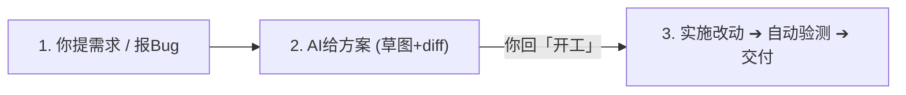

# Spotter 工作流极简实战手册 (WORKFLOW SPEC)

> **核心原则**：说人话、看草图、不瞎改、给凭证。  
> **模拟项目背景**：以通用商城后台 `shop-admin-nuxt`（Nuxt 3/4 + Nuxt UI + Nitro + Drizzle ORM + Vitest）为例，场景完全脱敏虚构。

---

## ⚡ 一分钟极简流程 (3 步搞定)

不管是加功能还是修 Bug，日常交互只有清爽的 3 步：



1. **第 1 步：你一句话发令**（如「在订单列表加个导出按钮」或「分页切到第 2 页报错 500」）。
2. **第 2 步：AI 先看不动代码**，画一张「改前 vs 改后」界面草图，给出一小段「拟议代码 diff」。
3. **第 3 步：你回复「开工」**，AI 实施修改，自动跑项目的测试/构建命令，拿着通过结果交差。

---

## 🛠️ 六大高频场景实战示范

### 场景 1：加功能（`/spot-plan`）

> **场景**：在商城订单管理页面，运营需要一键导出当前筛选条件下的订单为 Excel。

#### 1. 你的发令
```text
/spot-plan 在订单列表页面增加一个「导出 Excel」按钮，支持按当前筛选状态导出
```

#### 2. AI 的回复（只读核查，不擅自改代码）
AI 查阅 `app/pages/orders/index.vue` 和 `server/api/orders/`，直接输出：

* **改前/改后草图**：
  ```text
  [改前]
  [ 搜索框 ] [ 状态筛选: 全部 ▼ ]                 [ + 新建订单 ]
  -------------------------------------------------------------
  订单号: ORD-001 | 金额: 199.00 | 状态: 已支付

  [改后]
  [ 搜索框 ] [ 状态筛选: 全部 ▼ ]   [ 导出 Excel ] [ + 新建订单 ]
  -------------------------------------------------------------
  订单号: ORD-001 | 金额: 199.00 | 状态: 已支付
  ```

* **拟议代码修改点**：
  - 前端：`app/pages/orders/index.vue` 增加 `<UButton icon="i-lucide-download" @click="handleExport">`
  - 后端：新增 `server/api/orders/export.get.ts`，接收查询参数流式返回 xlsx
  - 拟议 diff 核心段落

* **下一步操作**：
  ```text
  【下一步操作】回复「开工」
  ```

#### 3. 你的操作
直接复制回复：
```text
开工
```
AI 开始修改代码，完成后运行 `pnpm typecheck && pnpm test`，输出测试通过凭据。

---

### 场景 2：修 Bug（`/spot-bug`）

> **场景**：点击订单列表第 2 页，控制台报 500 错误，列表卡住。

#### 1. 你的发令
```text
/spot-bug 点击订单列表第 2 页时接口报错 500
```

#### 2. AI 的回复（排查根因，绝不盲猜）
* **诊断分析**：
  - 复现链路：`GET /api/orders?page=2&pageSize=10`
  - 根因：`server/api/orders.get.ts` 中 `offset` 计算未转为整型，字符串拼接传入 Drizzle 查询导致 SQL 语法异常。
  - 因果关系：`page=2 为字符串 → offset = '10' + 0 导致查询崩溃`。

* **最小修复拟议 diff**：
  ```diff
  // server/api/orders.get.ts
  - const offset = (query.page - 1) * pageSize
  + const pageNumber = Number(query.page) || 1
  + const offset = (pageNumber - 1) * pageSize
  ```

* **验证用例**：
  - 测 `page=2` 正常返回第 11-20 条数据，HTTP 状态码 200。

* **下一步操作**：
  ```text
  【下一步操作】回复「开工」
  ```

#### 3. 你的操作
回复：
```text
开工
```
AI 完成修改，运行 `pnpm test tests/server/api/orders.test.ts` 确认退出码 0。

---

### 场景 3：理清模块链路（`/spot-trace`）

> **场景**：刚接手或准备重构「退款审核与退款原路返回」流程，代码分散在前后端各处，需要全景梳理。

#### 1. 你的发令
```text
/spot-trace 退款审核流程
```

#### 2. AI 的回复（只读梳理，5 个清晰模块）
1. **界面示意草图**：退款详情抽屉中的【同意退款】与【驳回】按钮。
2. **状态流转**：
   `待审核 ➔ (客服点击同意) ➔ 调第三方支付退款 ➔ 成功更新为已退款 / 失败回退为退款异常`
3. **前后端调用链路**：
   - 页面点击：`app/components/order/RefundModal.vue`
   - 请求提交：`POST /api/orders/refund/audit`
   - 后端逻辑：`server/api/orders/refund/audit.post.ts` 校验权限
   - 数据库更新：`drizzle/schema.ts` 的 `orders` 表 `refund_status` 字段
4. **涉及代码清单**（精确到文件与行号）。
5. **分级实施建议**：标注哪些属于轻度改动，哪些涉及金额与第三方接口需谨慎。

* **下一步操作**：
  ```text
  【下一步操作】回复「开始实施第 1 步」或「按 spot-plan 规划改造」
  ```

---

### 场景 4：把关代码质量（`/spot-review`）

> **场景**：功能改完了、测试也过了，想在合并或发布前做一次彻底的独立审查。

#### 1. 你的发令
```text
/spot-review
```

#### 2. AI 的回复（严格分类，绝不含糊）
AI 只读通读当前的所有改动，按 6 个维度核对后给出清单：

* **[Blocker]（阻断项，必须修复）**：
  - `server/api/orders/refund/audit.post.ts:45` 缺少并发防重复点击限制，快速连点可能导致重复退款。
* **[Nit]（建议项，不影响合入）**：
  - `app/pages/orders/index.vue:120` 变量 `d` 命名建议改为 `orderDate`，提升可读性。

* **下一步操作**：
  ```text
  【下一步操作】回复「修复审查意见」
  ```

#### 3. 你的操作
无需重新开题规划，直接回复：
```text
修复审查意见
```
AI 针对 Blocker 就地修复并复测，完成后直接告诉你结果。

---

### 场景 5：发版与部署（`/spot-release`）

> **场景**：所有功能与测试就绪，准备上线。

#### 1. 你的发令
```text
/spot-release
```

#### 2. AI 的回复
- **预检**：自动在终端运行构建命令 `pnpm build` 与语法校验，确认 exit code 为 0。
- **状态报告**：工作区干净、无未提交变更。
- **授权请求**：
  ```text
  【下一步操作】回复「确认发布」推进推送与部署跟踪
  ```

#### 3. 你的操作
回复：
```text
确认发布
```
AI 推进 Git 提交并跟踪远端部署流水线，成功后记录发布日志。

---

### 场景 6：代码体检与资产清理（`/spot-refactor`）

> **场景**：项目迭代多轮后代码膨胀，想清理无用文件、废弃老组件、死依赖，或拆分超大文件。

#### 1. 你的发令
```text
/spot-refactor --clean
```
*(也可输入 `/spot-refactor --structure` 专注大组件拆分，或 `/spot-refactor app/pages/orders/` 针对特定模块体检)*

#### 2. AI 的回复（只读体检，分类罗列并给零破坏依据）
AI 全仓扫描手写源码与静态资源，给出体检账单：

* **【闲置资产与死代码】**：
  1. `app/components/order/OrderDraftModalLegacy.vue`（未引用：已由通用抽屉替代，全仓 0 次引用）
  2. `public/images/2023-promotion-banner.png`（废弃静态大图：体积 4.2MB，代码中无消费点）
  3. `package.json` 中的 `xlsx-style`（死依赖：全仓已切换原生导出，无导入点）
* **【安全防线】**：
  - 动态引用排查：未发现通过动态 `import()`、`<component :is="...">` 或动态路由隐式调用的嫌疑。
  - 零破坏保障：剔除后自动执行 `pnpm typecheck` 验证无类型破坏。

* **下一步操作**：
  ```text
  【下一步操作】回复「批量安全清理」或「清理第 1 项」
  ```

#### 3. 你的操作
直接回复：
```text
批量安全清理
```
AI 执行安全剔除，自动运行 `pnpm typecheck && pnpm build` 确认构建通过（exit code 0），交付瘦身成果。

---

## 📋 常用命令速查对照表

| 你想做的事情 | 你只需这样说 | AI 的行为 | 你的回应 |
| :--- | :--- | :--- | :--- |
| **加新功能 / 改需求** | `/spot-plan 在订单页加个导出按钮` | 画改前改后草图，给拟议 diff | 回复「开工」 |
| **排查 Bug / 接口报错** | `/spot-bug 订单状态修改后没刷新` | 追溯根因，给最小修复 diff | 回复「开工」 |
| **摸清一个模块的代码** | `/spot-trace 订单发货流程` | 整理界面、状态、API到数据库全链路 | 选一步开始改 |
| **改完代码做严格审查** | `/spot-review` | 查出 `[Blocker]` 与 `[Nit]` | 回复「修复审查意见」 |
| **发布上线 / 盯部署** | `/spot-release` | 跑构建检查，授权后推送并跟踪 | 回复「确认发布」 |
| **代码体检 / 闲置清理** | `/spot-refactor app/pages/orders/` | 找出大文件/重复逻辑/死代码，立防线原地重构或清理 | 回复「重构第 1 项」或「清理第 X 项」 |
| **写本周周报** | `写本周周报` | 汇总本周任务凭据直接生成周报 Markdown | 复制使用 |

---

## 🔍 通俗的测试验证规则（怎么证明没改坏？）

在 Nuxt 等前端全栈项目中，改完代码后 AI 必须拿出真实的终端执行证据：

1. **项目有单测**：优先跑既有测试（如 `pnpm test`），必须看到终端实际输出且退出码为 0。
2. **纯前端/无单测**：运行静态类型检查与构建（如 `pnpm typecheck` 或 `pnpm build`），证明改动零语法/类型破坏。
3. **纯样式/文案微调**：如实说明在浏览器走查的表现。
